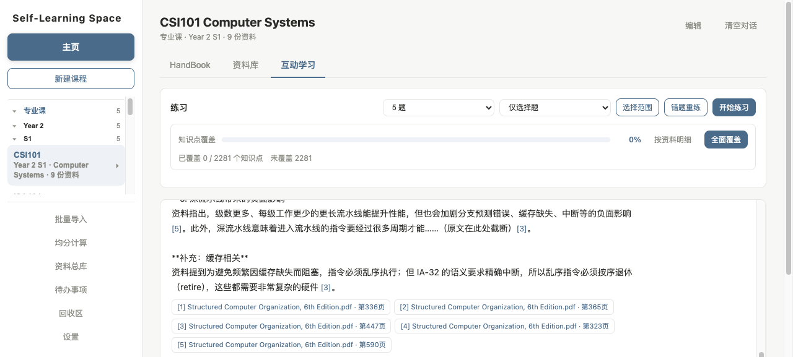
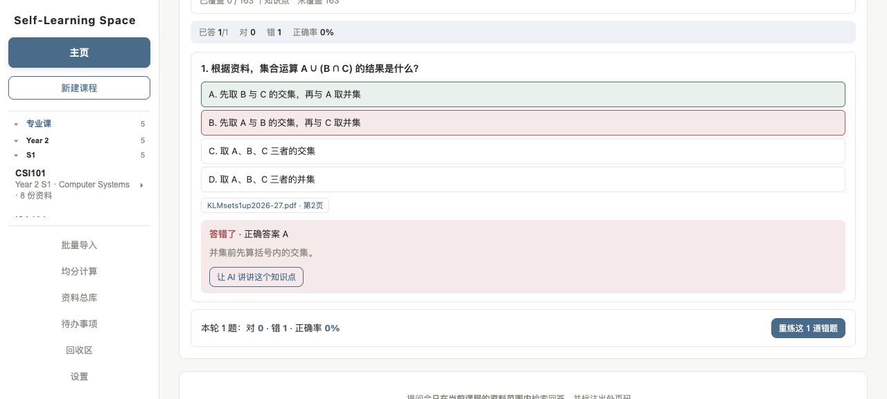
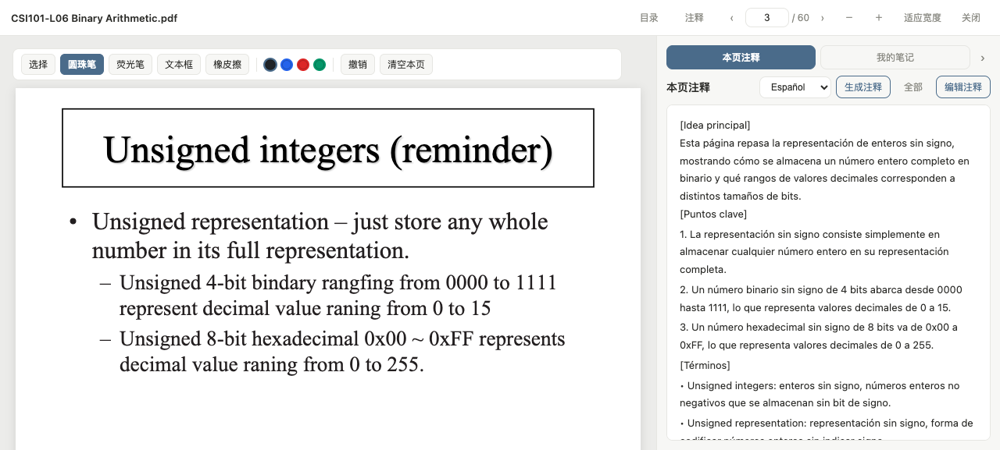
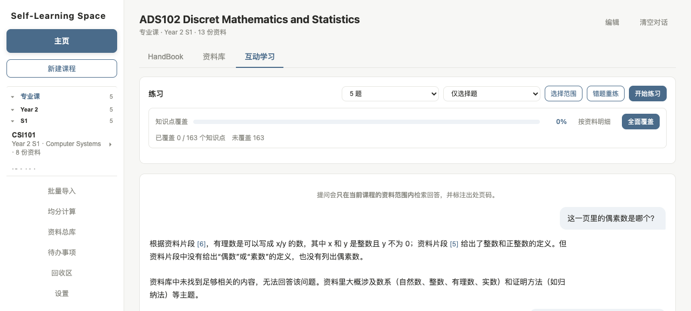

# Self-Learning Space · Local-first AI Study Assistant

[中文](README.md) | **English**

A fully **local-first** study workspace: organize your PDF/Word course materials by course, then ask questions answered **strictly from your own materials** — with page-level citations, and an explicit "not found" instead of a guess. Also includes in-reader annotation, per-page AI notes, and quiz generation.

> Built as a personal "second brain". All data stays on your machine (SQLite + files); the network is only used for LLM API calls.

## The problem it solves

A real scenario: your course slides are **English PDFs**, but you think and ask in **Chinese**. General AI assistants will:

- Not know what your course actually covers
- Give answers with no traceable source
- Answer "what does this slide say" from training data rather than your material

The core promise here: **answers must come from your materials, and each citation jumps to the exact page.**

## Features

| Module | Description |
|---|---|
| **Course & material management** | Organized by course code; PDF + docx; batch import (incl. zip); tags (lecture / exercise / past paper…); recycle bin with restore; export a single file or a zipped batch |
| **RAG Q&A** | Hybrid retrieval (dense + lexical) with Chinese→English term mapping; answers carry `[n]` citations that jump to the PDF page; **refuses to answer** when the material is insufficient. Handles "summarise L01" style requests that name a specific deck |
| **Per-page AI notes** | Auto-generated key points for every page, manually editable; available in **Chinese / English / Spanish**, each stored separately |
| **PDF reader** | Pen & highlighter, free-form text boxes on the page, outline/bookmark navigation, per-material notes |
| **Practice loop** | Instant grading on selection (decided server-side); a question stays "wrong" until answered correctly, then drops out; a wrong answer offers "let the AI explain this point", carrying the question back into chat |
| **Coverage tracking** | Materials are split into knowledge units and each one records whether it has been quizzed; daily practice and "full coverage" both advance the number, accumulating across sessions |
| **Study aids** | Handbook, assessment weighting, weighted GPA calculator, to-do list |

## Screenshots

**Answers always cite a page — click to jump to it:**



**Practice loop: instant grading; a wrong answer can send you back to the material via "let the AI explain this point":**



**Per-page notes in Chinese / English / Spanish, stored independently:**



**Coverage: turns "how much of this course have I revised" into a number:**



## Quick start

```bash
git clone git@github.com:Terrence20070515/Self-study_AI_Assistant.git
cd Self-study_AI_Assistant

python3 -m venv .venv && source .venv/bin/activate   # Windows: .venv\Scripts\activate
pip install -r requirements.txt

# Configure your API key (either way)
cp .env.example .env            # 1) put it in .env
export DEEPSEEK_API_KEY=sk-xxx  #    or export the env var
# 2) or fill it in via the in-app "Settings" panel (stored in local data/config.json)

python launcher.py              # desktop window (pywebview)
# or
bash start.sh                   # browser mode (Windows: start.bat)
```

The embedding model (~250 MB) downloads on first launch and runs locally via ONNX — offline afterwards.

> Requires Python 3.10+. Desktop mode uses the system WebView (WebView2 on Windows, built-in on macOS, `webkit2gtk` on Linux).

## Technical design

### RAG pipeline

```
parse (PDF/docx) → chunk (600 chars, 100 overlap) → embed (384-d multilingual)
                 → hybrid retrieval (dense 0.72 + lexical 0.28) → threshold → DeepSeek (with [n] citations)
```

**Two anti-hallucination measures**:
- Strict mode's system prompt says: *answer only from the provided excerpts, never use outside knowledge*
- When retrieval scores fall below the threshold, it returns "no sufficiently relevant content found" — **giving the model no chance to make things up**

### Three decisions worth explaining

**1. Embedding model: switched from Chinese-only to multilingual**

The initial choice was `BAAI/bge-small-zh-v1.5` (Chinese-only). But the corpus is mostly English while questions are in Chinese, and cross-lingual retrieval degraded badly:

| Query | Chinese-only | Multilingual |
|---|---|---|
| "什么是外键" (zh) | 0.464 (barely) | **0.530** |
| "外键的作用" (zh) | 0.469 | **0.508** |
| "How to create a table?" (en) | 0.794 | **0.826** |

**Same meaning, same corpus — just asking in Chinese drops the score by ~30%.**

**Takeaway**: when the material language differs from the query language, you need a multilingual model. Switching also requires **re-embedding everything** (dimensions change 512 → 384, and vectors of different sizes can't form a matrix).

**2. Why hybrid retrieval instead of pure dense**

Dense vectors are insensitive to exact terms — for `3NF`, `FOREIGN KEY`, `B+ tree`, pure dense retrieval often returns semantically-similar-but-wrong passages. So a lexical overlap score is blended in:

```python
final = dense_similarity × 0.72 + lexical_overlap × 0.28
```

For Chinese queries, a small **zh→en term map** expands terms (外键 → *foreign key*) so the lexical signal still works cross-lingually.

**3. Text selection: deleted my own implementation, handed it back to the browser**

This took three attempts:

1. "Can't select anything" → assumed WebView incompatibility → **real cause was a wrong coordinate matrix in the text layer**
2. "Selection is inaccurate" → assumed the scoring thresholds were bad → **real cause: I had built block-level selection, which can never match native character-level precision**
3. **Subtracted instead of adding**: deleted ~100 lines of my own code, stopped intercepting events — **worked immediately**

**Lesson**: ask *"does the browser already support this natively?"* before writing code. I was rebuilding a worse wheel and blocking the native one with `preventDefault()`.

### Project layout

```
backend/
  core.py        RAG pipeline: parse → chunk → embed → retrieve → generate
  store.py       SQLite data layer
  routers/       HTTP API split by domain
frontend/        Framework-free multi-module vanilla JS
data/            Runtime data (materials, DB, config) — gitignored
launcher.py      pywebview desktop shell
```

## Known limitations

- **Scanned/image-only PDFs are not supported** — OCR would be required
- Chunking is fixed-size sliding window; may cut sentences (no semantic boundary detection)
- No reranking stage — `top_k` takes the top N directly
- Answer quality depends on retrieval hit rate and the configured model

## Data & privacy

- All data (materials, DB, notes, chat history) lives **only in the local `data/` directory**; copying it is a complete backup
- API key via `.env` env var or the in-app settings — never hardcoded
- Fully offline except for LLM API calls (the embedding model runs locally)

## Platform support

| | Status |
|---|---|
| macOS | ✓ primary development platform |
| Windows | ✓ `start.bat` for browser mode; desktop mode needs WebView2 (preinstalled on Win11) |
| Linux | ✓ requires `webkit2gtk` for desktop mode |

## License

MIT
